# Algebra Quest

## About

Practice college algebra with lessons, graphs, flashcards and worked examples. On fields marked **fraction or decimal**, enter an exact fraction or a decimal rounded to at least three places. For example, both `1/3` and `.333` are accepted for one third. Explicit rounding and exact-form problems follow their own prompts.

**An interactive college algebra workbook.** Lessons that teach the method, hints that never give the answer, and flashcards that make it stick.

The burgundy-and-gold cover opens to today’s assignment. Inside, every page is a sheet of paper with a running head, numbered sections, worked examples, key-rule boxes and notes in the margin. Four chapters of college algebra, split into 27 short sections (quests). Each quest takes you through three steps: **learn** the idea from a short lesson, worked examples and interactive graph labs; **remember** it with spaced-repetition flashcards; then **use** it on endless, randomly generated practice problems. A wrong answer gets feedback about the specific mistake, and hints point to the next step of the method without ever giving the answer. Open **Review → Topics to retry** to return to a missed topic, even if you left the problem unfinished. A fresh first-try solve clears it from the list. The open-book icon identifies the installed workbook.

### ▶ [Study here](https://christianjkrantz.github.io/algebra-quest/)

Works in any modern browser on desktop, tablet or phone. No install, no account, no tracking. It also works offline once installed.

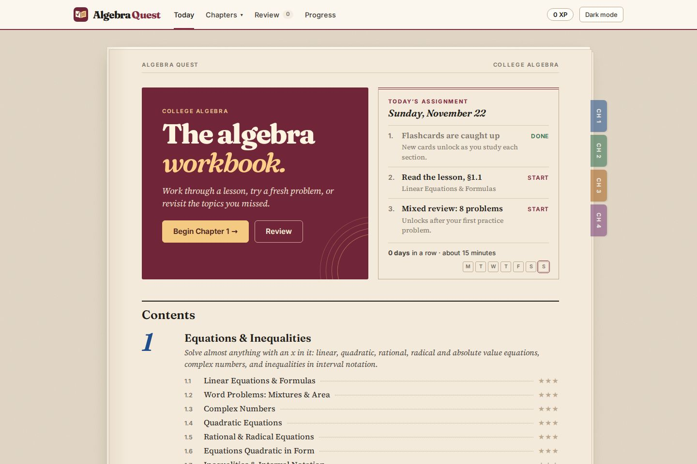

---

On flashcards, expand **Write an answer before flipping** to compare your recall with the answer. The deck summary counts first recalls separately from later attempts. During practice, **Get a hint** reveals one step at a time.

## What's inside

| Chapter | Quests |
|---|---|
| **1 · Equations & Inequalities** | Linear equations & formulas · Word problems: mixtures & area · Complex numbers · Quadratic equations · Rational & radical equations · Equations quadratic in form · Inequalities & interval notation · Absolute value |
| **2 · Graphs & Functions** | Distance & midpoint · Equations of lines · What is a function? · Circles · Reading graphs · Piecewise functions · Symmetry · Function operations & composition |
| **3 · Polynomial & Rational Functions** | Quadratic functions & max/min · Synthetic division & the Remainder Theorem · Factor Theorem & factoring · End behavior & polynomial graphs · Rational functions & asymptotes |
| **4 · Exponential & Logarithmic Functions** | One-to-one functions & inverses · Exponential equations · Compound interest · Logarithms ↔ exponents · Properties of logs: expand & condense · Solving logarithmic equations |

That adds up to **54 worked examples**, **10 interactive graph labs**, **134 flashcards** and **55 problem generators** with endless variations.

---

## Built for learning *and* remembering

Most study sites stop at "here's a problem, here's the answer." Algebra Quest is built around a few learning-science techniques with strong research behind them, and each one maps to a feature:

| Technique | What it means | Where you'll find it |
|---|---|---|
| **Worked examples** | Studying a solved problem one step at a time beats struggling through it blind when an idea is new | Every lesson's examples reveal one step per click, with a prompt to predict the next step first |
| **Retrieval practice** | Pulling an idea *out* of your memory strengthens it far more than reading it again | Flashcards, Recall mode, section summaries and the cheat sheet's Quiz-me mode |
| **Spaced repetition** | Reviewing right before you'd forget makes memories last longer | Flashcards come back after 1, 3, 7, 16, 35 and 60 days |
| **Interleaving** | Mixing problem types teaches you to *recognize* which method to use, which is half of every test | Daily mixed review and chapter reviews |
| **Immediate, specific feedback** | Knowing *what* went wrong right away stops mistakes from setting in | Every wrong answer gets a note about that exact mistake |

### Learn: lessons, worked examples and labs
Each section reads like a textbook page: numbered key-rule boxes, worked examples and labs (Example 1.4.2, Lab 3.1.1), with common traps and tips set in the margin beside the text. Every example uses its own numbers. Examples reveal **one step at a time**. Try the next step on paper, then click to check. When you're done, cover it and redo the whole thing yourself.

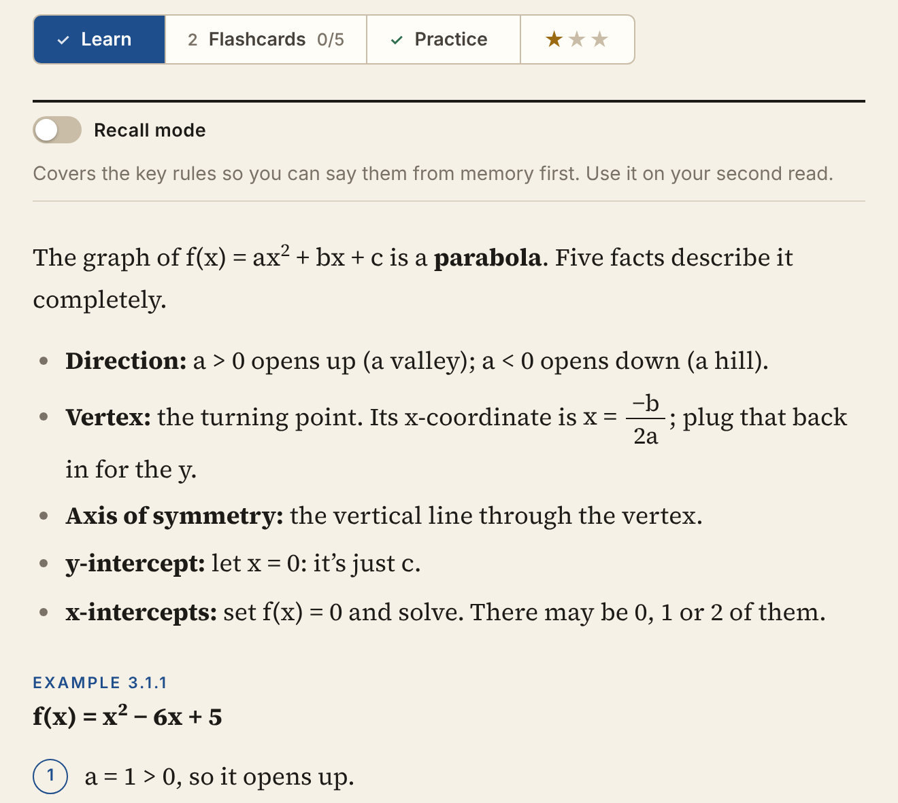

The **10 interactive labs** let you build intuition by playing:

| Lab | Quest |
|---|---|
| **Interval painter:** type `(-inf, 3) U [5, inf)` and watch it drawn on a number line | Inequalities & interval notation |
| **Line match:** read two points off a target line, then set slope and intercept to cover it | Equations of lines |
| **Circle match:** find the center and radius from labeled points | Circles |
| **Parabola match:** adjust a, h and k to cover a target parabola | Quadratic functions |
| **End-behavior lab:** change the degree and leading sign and watch both ends | End behavior |
| **Multiplicity lab:** see a graph cross at odd multiplicities and bounce at even ones | End behavior |
| **Rational lab:** move zeros and poles and watch the asymptotes move | Rational functions |
| **Inverse mirror:** a function and its inverse reflected across y = x | Inverses |
| **Exp & log lab:** why bˣ and log_b(x) are mirror images | Logarithms ↔ exponents |
| **Growth lab:** how much does compounding monthly vs. continuously really matter? | Compound interest |

**Your turn.** Right after the worked examples, before the section summary, every lesson hands you one fresh problem of the same kind, with the same hints and feedback as practice. You try the method while it's new instead of just reading it, and **Try another one** gives you more.

### Remember: flashcards, Recall mode and section summaries
**Flashcards.** Each quest has its own deck (134 cards in all) of the facts and methods you need to know cold: formulas, rules, "what's the first step when…". Say your answer before you flip, then rate yourself honestly:

| Rating | What happens |
|---|---|
| **Forgot** | Back to box 1, and you'll see it again before this session ends |
| **Shaky** | Comes back tomorrow |
| **Knew it** | Moves up a box. Boxes wait 1, 3, 7, 16, 35, then 60 days before the card comes back |

Cards that are due pile up in **Review**, with a count beside Review in the menu bar so you always know what's waiting.

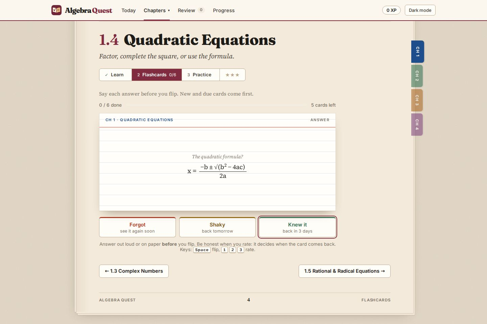

**Recall mode.** Flip the switch at the top of any lesson and every key rule is covered. Say each rule from memory, then tap to check. It's made for your second read-through.

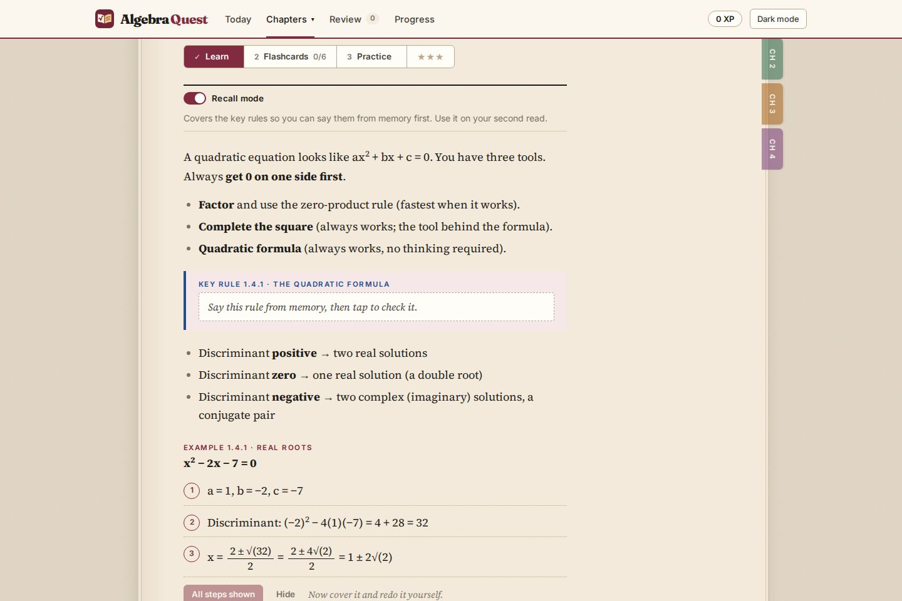

**Section summary.** Every lesson ends with the whole section in a few numbered lines. Cover them and test yourself before moving on.

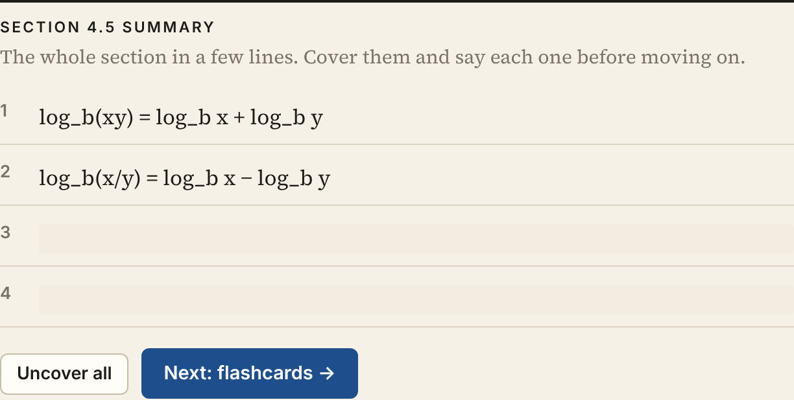

### Practice: endless problems, hints that never give it away

Open **Calculator** beside **Get a hint** in topic practice or mixed review. It handles fractions, parentheses, powers, roots and logarithms. Rational results appear as exact fractions when available. Select **Show decimal** for a decimal approximation, then close the calculator to continue with your answer still in place. Chapter challenges keep their existing format.
Every practice problem is generated fresh, so you can't memorize answers, only methods. Type answers the way you'd write them on paper (see [Typing math](#typing-math)).

- **Specific feedback.** Answers are checked for mathematical equivalence (so `1/2`, `0.5` and `2/4` all count) and for *form*. Wrong answers get a note about the exact slip: *"Right endpoints. Check the brackets: [ ] when the endpoint is included, ( ) when it isn't."* · *"You have the right numbers but in the wrong order. x comes first."* · *"That's the right value, but it isn't simplified yet. Write it in the form a + bi."* · *"Plug your value back into the original equation. Does it really work?"*
- **A hint ladder.** Each problem has two or three hints, revealed one at a time. Each one points to the next move in the method, and **no hint ever contains the answer**. The test suite checks this for every generated problem.
- **Worked answer on request.** If you're stuck, *Show the worked answer* gives the full step-by-step solution. That problem won't count toward your stars, so study the steps and try the next one cold.
- **Stars.** A quest earns ⭐ at 3, 8 and 15 problems solved on the first try without hints. The top of the practice page shows how close you are to the next star, and once the first one is earned it links to the next section.

<p>
  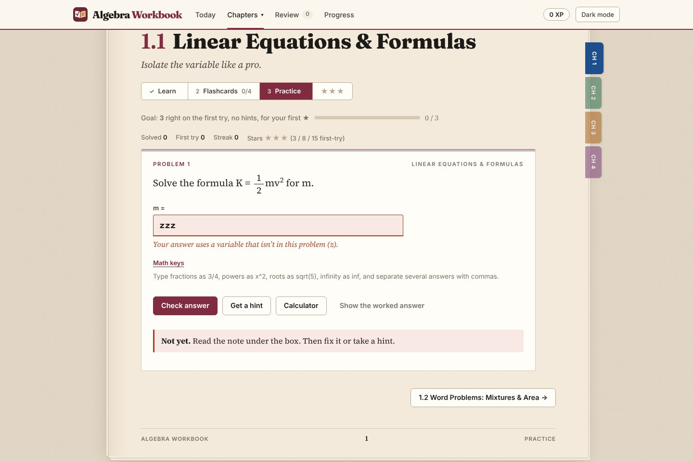
  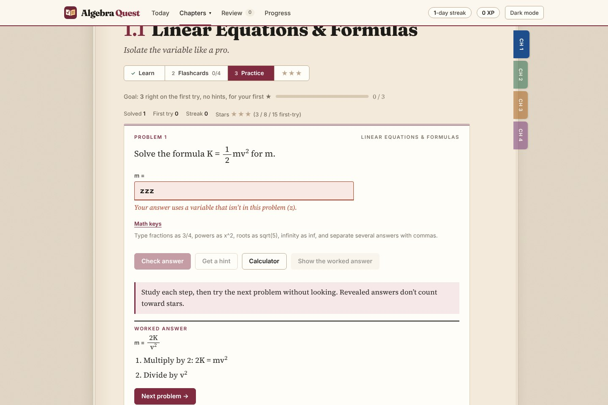
</p>

### Review: daily assignment, mixed sets and chapter reviews
- **Today's assignment** on the title page puts about 15 minutes of work in order: flashcards due → your next quest step → a mixed problem set. It also shows your day streak and a 7-day calendar.
- **Mixed review:** 8 problems drawn from every topic you've practiced, weighted toward the ones you miss most and the ones you haven't seen lately. Nothing tells you which method to use, just like on a test.
- **Chapter reviews:** 10 mixed problems covering every quest in a chapter. First-try answers earn 10 points, later answers 5, and revealed answers 0. Afterward you get a list of quests worth another look, with links to their lessons and flashcards.

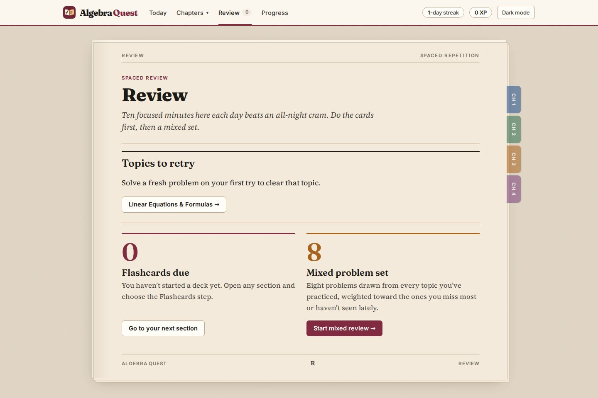

### Practice-test prep map
Each chapter page lists the skill behind every problem on that chapter's practice test and links to the quest that teaches it. It gives **only the skill, never the problem or its answer**.

The practice problems are guaranteed never to reproduce a practice-test problem. [`tests/test_no_test_problems.js`](tests/test_no_test_problems.js) generates hundreds of thousands of problems and scans every lesson, example and flashcard to prove it. To keep the test problems themselves out of this public repo, it compares against SHA-256 fingerprints of them instead of the problems.

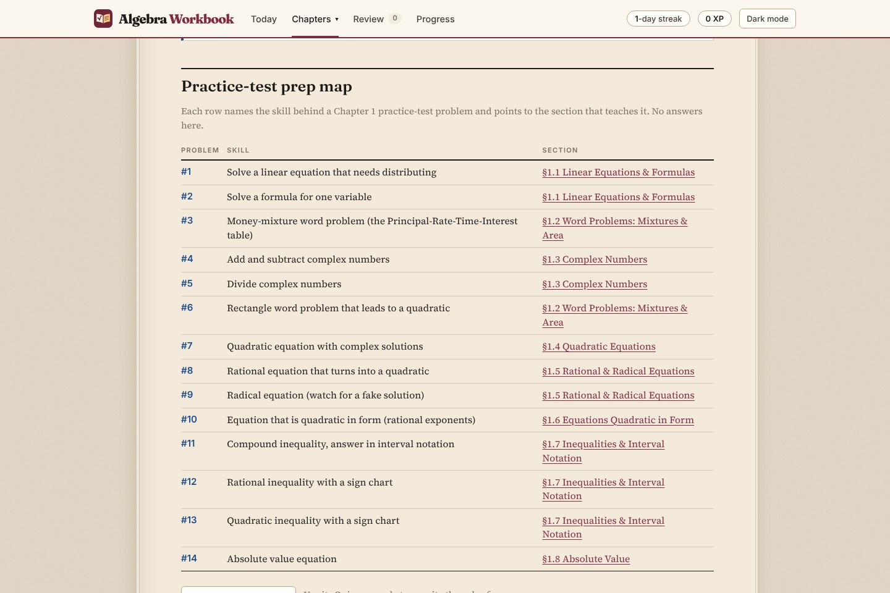

### Cheat sheets with a Quiz-me mode
Every chapter has a one-page cheat sheet of the rules, ready to print. **Quiz me** covers every line so you can write the rules from memory onto a notecard, then tap each one to check.

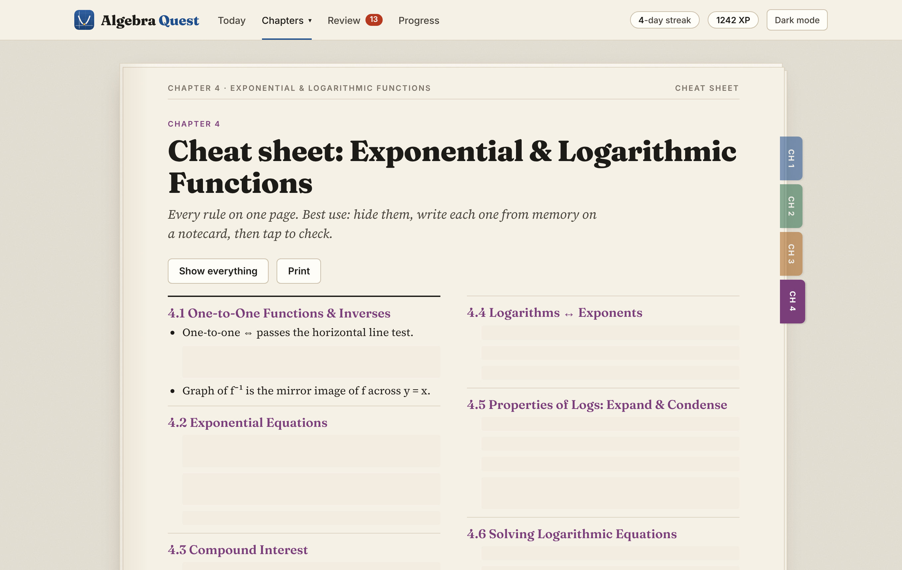

### Progress
The progress page shows your day streak, cards learned, stars, problems solved and XP, plus a chart of how many cards sit in each memory box. A table for each chapter shows, per quest, whether you've read the lesson, your memory strength, your stars and your first-try rate.

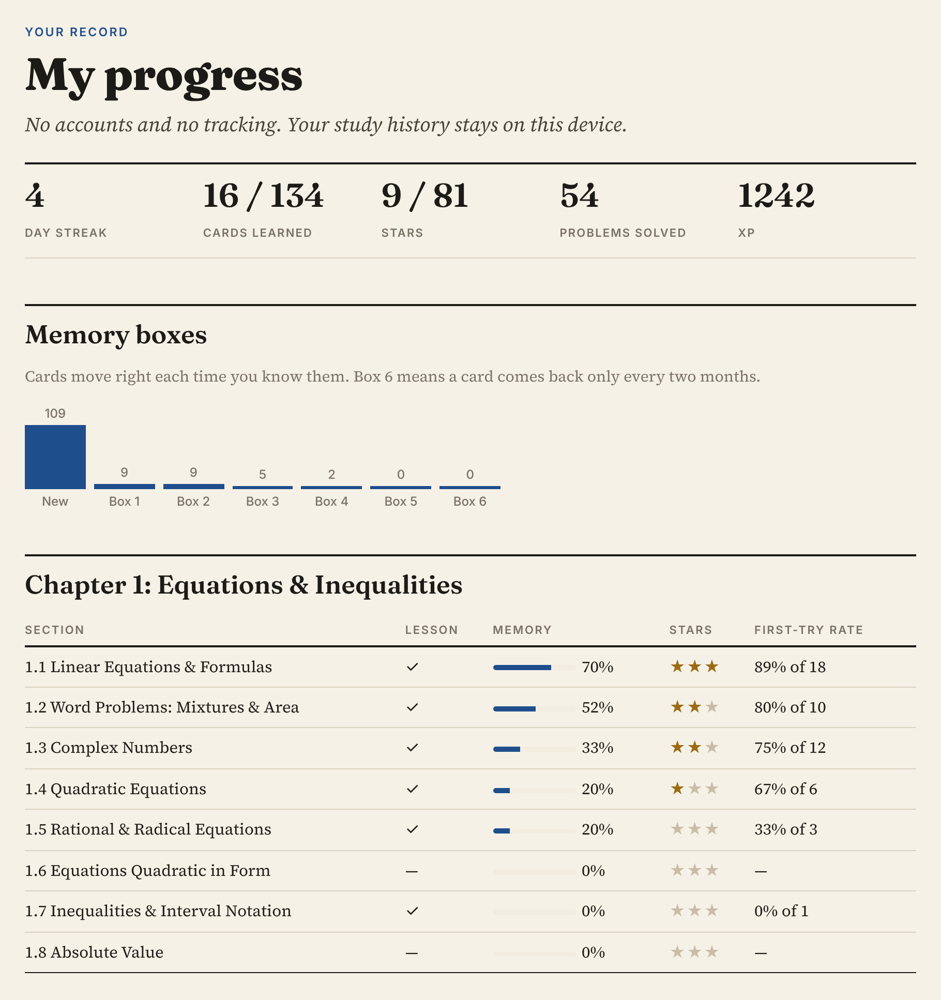

### Dark mode
Day mode is cream paper on a light desk; dark mode is a reading-lamp version that's easy on the eyes at night. It follows your device setting by default, and the button in the menu bar switches it.

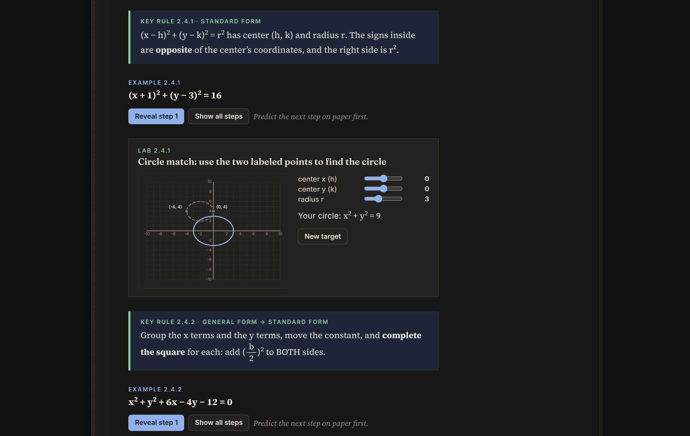

### Made for phones too
On a phone the page fills the screen, the chapters open as a slide-out table of contents, and the section steps fit across the screen. The three flashcard buttons sit within one thumb's reach.

<p>
  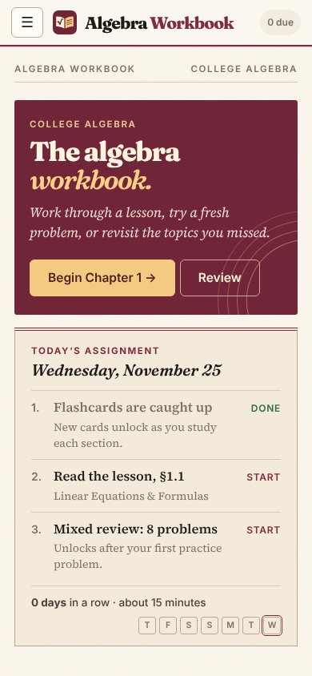
  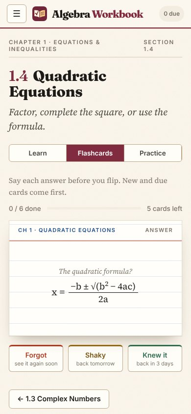
  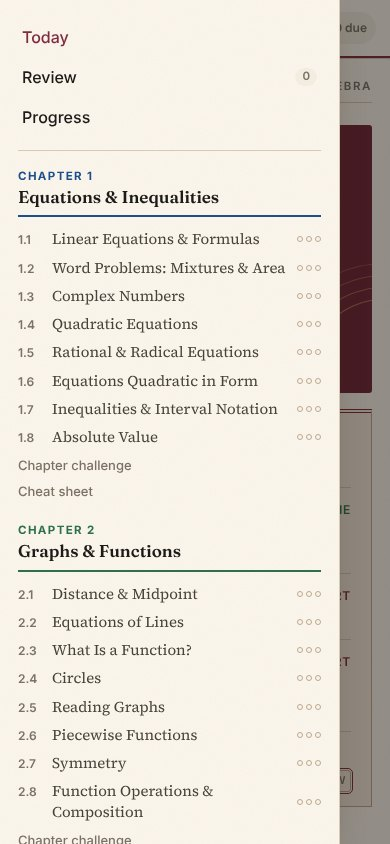
</p>

### Designed for readability
- Set like a book: **[Source Serif 4](https://github.com/adobe-fonts/source-serif)** for reading, **[Fraunces](https://github.com/undercasetype/Fraunces)** for headings and **[Inter](https://rsms.me/inter/)** for labels and buttons.
- Typed answers use **AQ Legible Mono**, a version of [Atkinson Hyperlegible Mono](https://www.brailleinstitute.org/freefont/) with the slash removed from the zero so it can't be confused with the empty-set symbol ∅.
- Fractions are drawn stacked (numerator over denominator), with real superscripts, subscripts and minus signs.
- A real page: subtle paper grain, a page stack and running heads, colored chapter tabs on the page edge, and a table of contents with dotted leaders.
- Full keyboard support, visible focus outlines, screen-reader labels and live feedback regions. Animations switch off if your device asks for reduced motion.

---

## Typing math

| To write | Type | Example |
|---|---|---|
| Fraction | `/` | `3/4`, `(x - 3)/2` |
| Power | `^` | `x^2`, `2^(x+1)` |
| Square / cube root | `sqrt( )`, `cbrt( )` | `2sqrt(17)`, `cbrt(x - 2)` |
| π, e, i | `pi`, `e`, `i` | `3 - 4i` |
| Infinity, union | `inf`, `U` | `(-inf, 1) U [4, inf)` |
| Logs | `log_b( )`, `ln( )`, `log( )` | `log_2(8) = 3` |
| Absolute value | `\| \|` | `\|x - 3\|` |
| Several answers | commas | `-2, 5` |

Multiplication can be implied (`2x`, `3(x+1)`), and a **⌨ Math keys** button under each answer box inserts the trickier symbols with a tap.

## Keyboard shortcuts

| Key | Action |
|---|---|
| `Enter` | Check the answer |
| `Space` / `Enter` | Flip a flashcard |
| `1` `2` `3` | Rate a flashcard: Forgot / Shaky / Knew it |
| `Esc` | Close the menu (phone) |

---

## Install it and use it offline
Algebra Quest works as an app. Install it once and it opens full screen from its own icon, and it keeps working with no internet connection.

- **iPhone / iPad:** open the site in Safari, tap **Share**, then **Add to Home Screen**.
- **Android / Chrome / Edge:** tap **Install app** in the menu bar, or use the browser's install option.

A service worker saves a copy of the site, including its fonts, on your device on your first visit. Online, you always get the newest version; offline, the saved copy loads instead. Your progress is stored on the device either way.

## Privacy
There is no server, no account, no analytics and no cookies. Your stars, flashcard schedule, streak and XP are stored only in your own browser (`localStorage`). **My progress → Erase my progress** clears them.

## Security
The site is static, so the main risks are someone injecting code into the page or disguising it inside another site. It's hardened against both:

- **Typed input is never run.** Answers are read by the site's own small math parser and only ever displayed as text. HTML or script typed into a box just appears as text.
- **Content Security Policy.** The page only runs its own script files: no inline scripts, no scripts from other sites, no `eval`, no plugins, forms or `<base>` tags.
- **No third-party requests.** Fonts are self-hosted, and the page sends no referrer, so nothing about your visit goes to another site.
- **Saved data is validated.** Everything read back from browser storage is type-checked, range-clamped and limited to known quests and cards, so tampered or corrupt data can't inject anything, pollute objects or crash the site. If storage is blocked, the site still works for that visit.
- **Links are cleaned.** Anything odd in the address (`#/ch/1/<script>…`) is stripped before use.
- **No framing.** If another site loads Algebra Quest inside a frame, it shows only a link to the real page.
- The service worker only handles and caches this site's own files.

[`tests/test_security.py`](tests/test_security.py) attacks all of this. See [Tests](#tests).

---

## Running it locally
Plain static files with no build step and no dependencies. Serve the folder with any static server:

```bash
python3 -m http.server 8000
# then open http://localhost:8000
```

Opening `index.html` directly also works, but browsers only enable offline mode over `http://localhost` or `https://`. To host it yourself, any static host works (GitHub Pages, Netlify, a USB stick…).

## Tests
The `tests/` folder checks the math, the content, the interface, security and offline support:

- **`test_generators.js`** (Node) runs every one of the 55 problem generators hundreds of times. For each problem it checks that the site's own answer passes its checker, that junk and near-miss input is rejected, that every multiple-choice question has exactly one right option, and that **no hint contains the answer**.
- **`test_no_test_problems.js`** (Node) proves that no generated problem, worked example, lesson or flashcard reuses a practice-test problem. It compares each one against SHA-256 fingerprints of the test problems' numbers and variables. It found six near-copies during development, and those generators were fixed.
- **`test_learning.py`** (Playwright) checks that all 27 lessons end their examples with a Your turn problem before the summary, that it counts as practice, and that practice shows the star goal and then the next section.
- **`test_ui.py`** (Playwright) opens every lesson, lab, flashcard deck and practice set on a desktop and a phone screen. It answers and rates through them, runs Recall mode, mixed review and a chapter challenge, switches themes, and checks for console errors, horizontal overflow, unrendered math and saved progress.
- **`test_security.py`** (Playwright) types injection payloads into every answer box in all 27 quests and into the lab inputs, sends malicious links, and loads tampered, corrupt and prototype-polluting saved data. It also blocks browser storage, checks the Content Security Policy and that nothing loads from other sites, and frames the page from another origin.
- **`test_offline.py`** (Playwright) loads the site once, cuts the network, then reads a lesson, uses a graph lab, rates flashcards and solves a practice problem offline (fonts included). It checks that a new version is picked up when back online and that the app manifest and icons are valid.

```bash
pip install playwright && playwright install chromium
N=300 node tests/test_generators.js        # N = problems per generator
N=5000 node tests/test_no_test_problems.js
python3 tests/test_learning.py
python3 tests/test_ui.py
python3 tests/test_security.py
python3 tests/test_offline.py
```

## Project layout

```
index.html            page shell and Content Security Policy
css/style.css         the design system (light + dark themes)
js/engine.js          math parser, answer checkers and math text renderer
js/graph.js           small SVG graphing library
js/gens1.js, gens2.js the 55 problem generators (Chapters 1–2 and 3–4)
js/content.js         lessons, worked examples, cheat sheets and prep maps
js/cards.js           the 134 flashcards
js/widgets.js         the 10 interactive labs
js/app.js             router, page layout, flashcards, practice, review and progress
sw.js                 offline support
fonts/                self-hosted fonts and their licenses
tests/                the test suite
docs/                 README screenshots
```

## Built with
Plain HTML, CSS and JavaScript, about 3,400 lines in total, with no frameworks, no build step and no dependencies. Graphs are hand-rolled SVG. Fonts are self-hosted Fraunces, Source Serif 4, Inter and AQ Legible Mono (based on Atkinson Hyperlegible Mono), all under the SIL Open Font License.

## About
Made by **Christian Krantz** as a study aid for MAT 115 College Algebra at State Technical College of Missouri. Its companion project, [Subnet Sprint](https://github.com/ChristianJKrantz/subnet-sprint), does the same for IPv4 subnetting.

## License
Code: [MIT](LICENSE). Fonts: SIL Open Font License 1.1 (see [`fonts/`](fonts/)).
